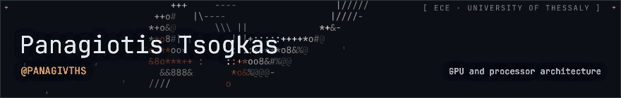
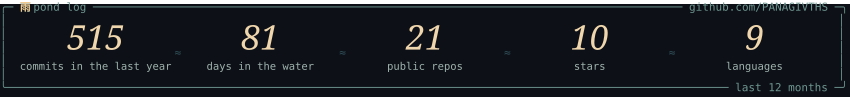
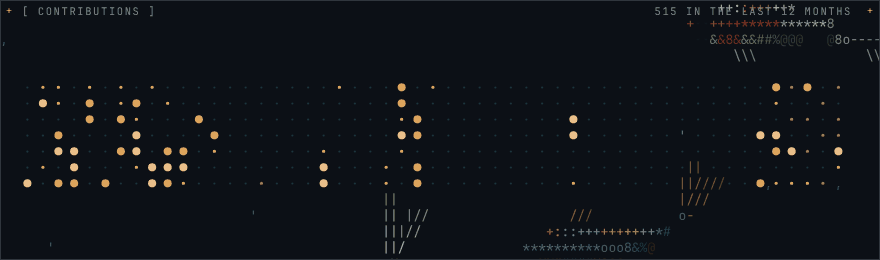
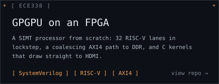
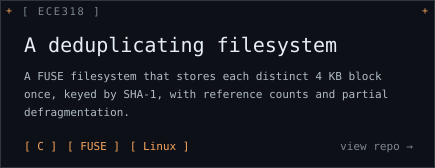
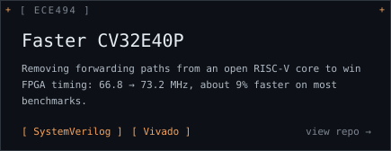
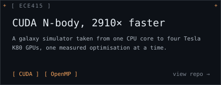
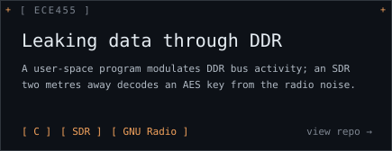
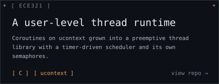

<b>More projects</b>

 

| project | what it is | built with |
|:--|:--|:--|
| [**Smith-Waterman on an FPGA**](https://github.com/PANAGIVTHS/ECE340-Embedded-Systems) | Sequence alignment as an HLS accelerator, pipelined to II = 1 | Vitis HLS · Zynq |
| [**3D house**](https://github.com/PANAGIVTHS/ECE433-Computer-Graphics) | An explorable OpenGL scene with day and night, lights, OBJ models and NURBS | C++ · OpenGL |
| [**FPGA drivers**](https://github.com/PANAGIVTHS/Vivado-Projects) | Seven-segment, UART, VGA and an SPI accelerometer, from scratch | Verilog · Vivado |
| [**Pipelined MIPS**](https://github.com/PANAGIVTHS/ECE219-Computer-Organization) | A MIPS CPU in Verilog with forwarding and stalls, plus cache experiments | Verilog |
| [**Ferra**](https://github.com/PANAGIVTHS/Ferra) | An interpreted programming language | C |
| [**Pond-In-The-Rain**](https://github.com/PANAGIVTHS/Pond-In-The-Rain) | My site: a koi pond drawn in text, in the rain. The koi below come from its engine. | JavaScript · Canvas |

<a href="https://github.com/PANAGIVTHS">GitHub</a> · <a href="https://www.linkedin.com/in/panagiotis-nikolaos-tsogkas-650871293/">LinkedIn</a> · <a href="https://github.com/PANAGIVTHS/Pond-In-The-Rain">Pond-In-The-Rain</a>

