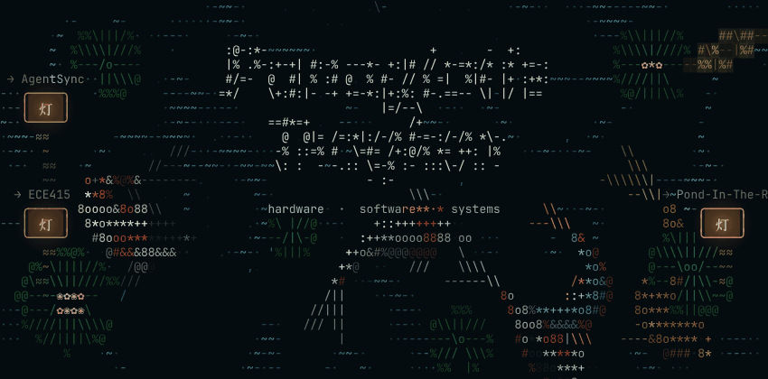
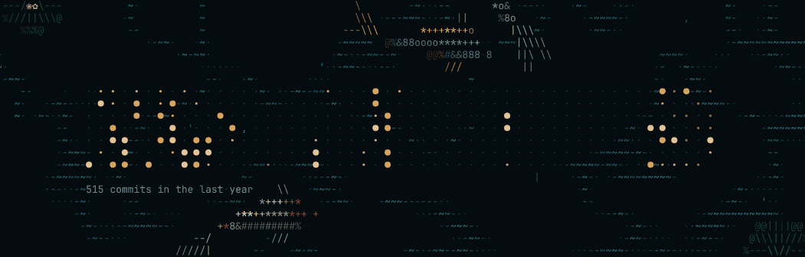

  

  Electrical and Computer Engineering · University of Thessaly · GPU and processor architecture

### 私 &nbsp;about

I'm an **Electrical and Computer Engineering** student at the University of Thessaly, interested in **GPU and processor architecture**: how a design turns into pipelines, memory systems and timing paths, and how software ends up using them. My largest project so far is a SIMT GPGPU written from scratch in SystemVerilog that runs C kernels on an FPGA and draws to HDMI.

### 池 &nbsp;commits in the water

Every crumb is a day with commits, bigger for busier days. The koi come from the site's own pond engine, the one behind <a href="https://github.com/PANAGIVTHS/Pond-In-The-Rain">Pond-In-The-Rain</a>.

### 作 &nbsp;featured

### 学 &nbsp;all projects

| | project | what it is | built with |
|:-:|:--|:--|:--|
| 算 | [**GPGPU on an FPGA**](https://github.com/PANAGIVTHS/ECE338-Parallel-Computer-Architecture) | A SIMT processor from scratch: 32 RISC-V lanes in lockstep, coalescing AXI4 memory, C kernels drawing to HDMI | `SystemVerilog` `RISC-V` `AXI4` |
| 核 | [**Faster CV32E40P**](https://github.com/PANAGIVTHS/ECE494-Microprocessor-Design) | Removing forwarding paths from a RISC-V core to win FPGA timing: 66.8 → 73.2 MHz | `SystemVerilog` `Vivado` |
| 蔵 | [**Deduplicating filesystem**](https://github.com/PANAGIVTHS/ECE318-Operating-Systems) | FUSE filesystem storing each 4 KB block once, keyed by SHA-1, with reference counts | `C` `FUSE` `Linux` |
| 速 | [**CUDA N-body**](https://github.com/PANAGIVTHS/ECE415-High-Performance-Computing) | A galaxy simulator from one CPU core to four K80 GPUs: 2910× faster | `CUDA` `OpenMP` |
| 漏 | [**Air-gap DDR leak**](https://github.com/PANAGIVTHS/ECE455-Hardware-Security) | A covert channel: DDR bus activity read by an SDR two metres away | `C` `SDR` `GNU Radio` |
| 糸 | [**User-level threads**](https://github.com/PANAGIVTHS/ECE321-Concurrent-Programming) | A preemptive thread library on ucontext with its own scheduler and semaphores | `C` `ucontext` |
| 列 | [**Smith-Waterman on an FPGA**](https://github.com/PANAGIVTHS/ECE340-Embedded-Systems) | Sequence alignment as an anti-diagonal HLS accelerator, pipelined to II = 1 | `Vitis HLS` `Zynq` |
| 灯 | [**3D house**](https://github.com/PANAGIVTHS/ECE433-Computer-Graphics) | An explorable OpenGL scene with day and night, lights, OBJ models and NURBS | `C++` `OpenGL` |
| 回 | [**FPGA drivers**](https://github.com/PANAGIVTHS/Vivado-Projects) | Seven-segment, UART, VGA and an SPI accelerometer, from scratch in Verilog | `Verilog` `Vivado` |
| 器 | [**Pipelined MIPS**](https://github.com/PANAGIVTHS/ECE219-Computer-Organization) | A MIPS CPU in Verilog with forwarding and stalls, plus cache experiments | `Verilog` `MIPS` |
| 語 | [**Ferra**](https://github.com/PANAGIVTHS/Ferra) | An interpreted programming language | `C` |
| 雨 | [**Pond-In-The-Rain**](https://github.com/PANAGIVTHS/Pond-In-The-Rain) | My site: a koi pond drawn in text, in the rain | `JavaScript` `Canvas` |

### 道 &nbsp;languages and tools

### 文 &nbsp;say hello

[GitHub](https://github.com/PANAGIVTHS) · [LinkedIn](https://www.linkedin.com/in/panagiotis-nikolaos-tsogkas-650871293/)

雨の池 · made of text and rain

